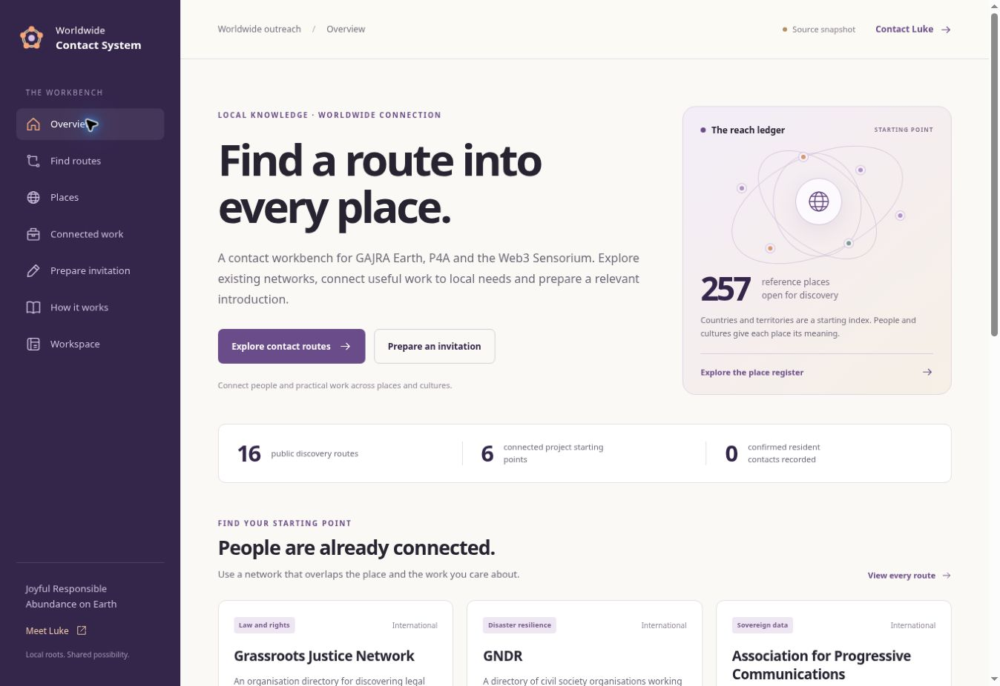

# Worldwide Contact System

A contact workbench for Luke Nathan Hayes / Aura of Intelligence: discover routes into places and communities, connect useful work to local interests, prepare an introduction and keep the next action clear.

- [Website](https://auraofintelligence.github.io/outreach-cms/)
- [Public Google Sheets CMS](https://docs.google.com/spreadsheets/d/1tntEkuyWQs4cPY-MPiSmvDq-K7cGT8AmxqsL3s22soU/edit)
- [Private contact workspace](https://docs.google.com/spreadsheets/d/1Tapws8HTbiTlBk3-O0Og10QBzxoy0N6Yb3jpBzxJYKk/edit) — Google account access required
- [Editor and setup guide](docs/cms-guide.md)
- [Reference data, checks and attribution](docs/data-sources.md)

The starting catalogue contains 13 connected projects, 16 public discovery routes and 257 reference places derived from Unicode CLDR. A directory lead is not an established relationship. Countries, territories, Indigenous nations and self-described communities need distinct records; the country and territory index does not claim cultural representation. Confirmed contact totals begin at zero.



## Everyday use

1. Search **Find routes** by theme and scope; check a local organisation's own information.
2. Choose a place and a project, then prepare an invitation in your browser.
3. Keep actual contacts, outreach, permissions, communities and next actions in the private workbook.
4. Edit public sources, projects, headings and approved aggregate counts in the CMS.

The invitation tool can copy or download a draft and open your email app. Messages are sent only through the channel you choose. The website and workflows do not send outreach.

## Publishing

`Publish website` fetches only the five documented public CMS tabs, validates their columns and values, runs publication checks, builds static HTML and deploys through GitHub Pages. It runs on a push to `main`, manually, and every six hours. GitHub may delay scheduled jobs.

`Check proposed changes` validates pull requests using the checked-in public snapshot. `Review source links` produces a weekly link report in its Actions summary; an access restriction is reported separately from a missing URL.

The public editorial workbook contains no private CRM records. Its planned Viewer-by-link sharing is awaiting owner approval; until enabled, the deployed website uses the labelled source snapshot. `pending_spreadsheet_id` records the prepared workbook in `cms.config.json`; move that value into `spreadsheet_id` after sharing is approved and verified. Its `publish` column controls inclusion in the website, not visibility inside that workbook. The private workbook remains restricted and is never a publishing input.

## Local development

Python 3.10+ and a modern browser are sufficient; there are no build dependencies.

```sh
python3 -m unittest discover -s tests -v
python3 scripts/build.py --offline
```

Output is in `.site/`. Serve that directory with a local static server. Without `--offline`, a configured CMS is fetched. If the configured CMS is unavailable or invalid, the build fails and the previous successful deployment stays live. An explicitly unconfigured CMS uses the labelled source snapshot.

See [AGENTS.md](AGENTS.md) before changing publication or contact handling.

## Rights

Original work is available under the [Strange But True Public Source Licence](LICENCE.md), with commercial, corporate, institutional and government rights reserved as set out in that licence. This is public source, not an open-source grant. Unicode reference data retains its [separate licence and attribution](docs/data-sources.md).
