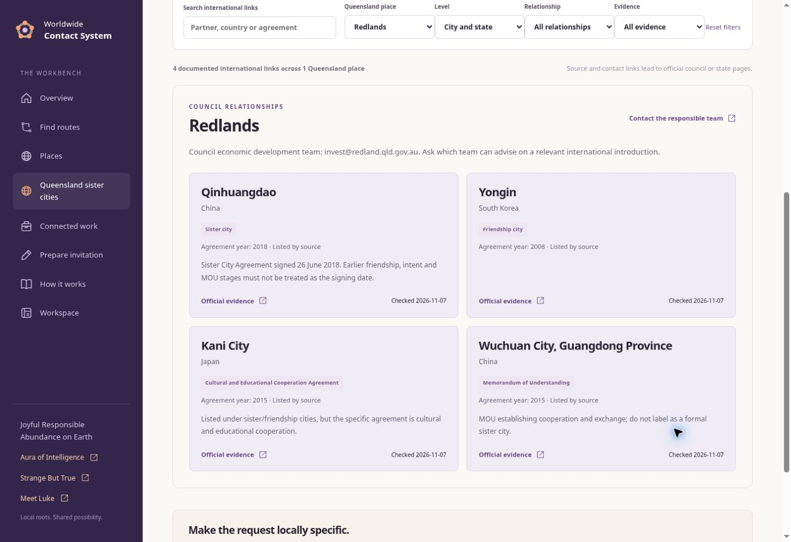

# Worldwide Contact System | Outreach CMS

[Open the Worldwide Contact System](https://auraofintelligence.github.io/outreach-cms/)

A worldwide contact and relationship-development workbench for Luke Nathan Hayes / Aura of Intelligence. Its purpose is to discover appropriate routes into places and communities, connect useful projects with local interests, prepare introductions and preserve the next action and the history of each relationship.

The longer-term aim is to build genuine connections with people across countries, territories, languages and cultures, without treating national boundaries, institutions or mailing lists as substitutes for actual relationships. English-speaking contacts can help begin conversations across regions, but a listing does not establish language ability, independence, willingness to participate or authority to represent a community.

**README reviewed 25 November 2026.** Current catalogue snapshot: 7 November 2026, source commit `5239410`. Source dates remain distinct from the date the site is rebuilt.

## Start here

| Public page | Purpose |
| --- | --- |
| [Overview](https://auraofintelligence.github.io/outreach-cms/) | Worldwide discovery, connected projects and the distinction between potential routes and established relationships |
| [Find routes](https://auraofintelligence.github.io/outreach-cms/routes.html) | Search and filter public organisations and networks by project, theme and geographic scope |
| [Places](https://auraofintelligence.github.io/outreach-cms/places.html) | Searchable place reference catalogue, relationship-development stages and approved aggregate progress |
| [Queensland sister cities](https://auraofintelligence.github.io/outreach-cms/sister-cities.html) | Documented international relationships, evidence, status and official council/state contact routes |
| [Connected work](https://auraofintelligence.github.io/outreach-cms/projects.html) | Project cards with relevant outreach-body filters and invitation starting points |
| [Prepare invitation](https://auraofintelligence.github.io/outreach-cms/invite.html) | Browser-local drafting, copying, downloading and opening an email application |
| [How it works](https://auraofintelligence.github.io/outreach-cms/playbook.html) | Practical research, contact, consent and relationship-development procedure |
| [Workspace](https://auraofintelligence.github.io/outreach-cms/workspace.html) | Public CMS and restricted Google workbook entry points, publication mode and maintenance information |

The generated site also provides privacy, licence, sitemap, source-attribution and not-found pages.

## Catalogue and evidence

The checked-in public snapshot contains:

| Record type | Count |
| --- | ---: |
| Connected project cards | 18 |
| Public discovery routes | 41 |
| Reference places | 257 |
| Queensland council-level international relationships | 78 |
| Queensland sister-state agreements | 5 |
| International relationship records, total | 83 |
| Confirmed resident contacts recorded in the public snapshot | 0 |
| Participating cultural communities recorded in the public snapshot | 0 |

The zero totals describe only the reviewed public snapshot. The private workspace was not inspected for this README review; these totals are not a claim about actual private relationships.

### Worldwide place reference

| CLDR macroregion | Reference places |
| --- | ---: |
| Africa | 62 |
| Americas | 57 |
| Asia | 51 |
| Europe | 53 |
| Oceania | 34 |
| Total | 257 |

The reference places derive from Unicode CLDR territory names and containment, retrieved 31 October 2026. They include countries, territories and special geographic reference codes. This is not a count of sovereign states or Indigenous nations, nor an authoritative map of cultures.

Maintain residence, citizenship, diaspora connections, language and self-described community separately where relevant. A person may belong to several communities or none of the categories proposed by a researcher. The initial stages are Seeking contacts, Route identified, In conversation and Resident connection. A resident connection requires a confirmed resident contact; an institutional directory alone does not qualify.

See [data provenance and Unicode attribution](docs/data-sources.md).

## Connected projects

The catalogue deliberately selects 18 outreach entry points rather than importing every repository from [Project Atlas](https://auraofintelligence.github.io/project-atlas/). Each card links to the project itself, a draft invitation and a filter for relevant public discovery routes.

| Project family | Current project cards |
| --- | --- |
| Law and local relevance | Your Relevance in every jurisdiction; Australian Legal Engine |
| Sovereign capacity and productive ownership | Installing the Missing Middle; Mutual Futures |
| Civic participation | P4A Australia; P4A Oceania; P4A Native Nations |
| Global cooperation | GAJRA Earth Infinity; GAJRA Earth Claude; GAJRA Earth Community |
| Personal intelligence and practical applications | Aura Genesis; Aura Tourism; Aura Disaster Resilience; Aura Children & Young People; Aura Whole-of-Life Support; Verse Box |
| Shared purpose and public research | A fair go in the age of intelligence; Joyful Responsible Abundance |

[Aura of Intelligence](https://auraofintelligence.github.io/) and [Strange But True](https://auraofintelligence.github.io/strange-but-true/) also have sidebar entry points.

P4A, GAJRA Earth, Aura of Intelligence and the other projects retain their distinct purposes, operating authority and terms. A suggested project fit does not mean that the organisation has expressed interest, approved a pilot, entered a partnership or endorsed any political project. Native Nations' own self-description and independent onboarding are not political membership funnels.

Future catalogue changes should prioritise relevant, current work and retain project status, purpose and source evidence. Earlier, archived or superseded projects should not automatically become outreach targets merely because they appear in a wider portfolio.

## Public organisational discovery

The 41 routes comprise 20 entries marked Directory checked and 21 marked Research route. The 7 November research pass added 24 organisation/network entries and the separate Queensland international-relations entry to the earlier sixteen routes.

The public catalogue supports nine themes: law, resilience, technology, cooperation, culture, civic participation, community, education and livelihoods. Source records map to one or more project IDs. This is a many-to-many relationship: the same organisation can be relevant to multiple projects without being counted as several contacts.

The researched bodies include legal and justice networks, Internet and technical associations, Indigenous-controlled organisations and data-governance resources, child and family services, disability and dementia organisations, tourism and education associations, employee ownership and cooperative networks, and community engagement bodies.

Source records retain public organisational URLs, contact guidance, dates, status and research limitations. Use the organisation's own appropriate public enquiry route after checking current suitability. Do not scrape personal member lists, treat a directory as a mailing list, or infer permission to contact individuals. Respect organisation-specific terms, cultural protocols and a person's decision not to engage.

[7 November outreach research and suggested project fit](docs/outreach-research-2026-11-07.json) retains the 24 new records, primary evidence, limitations and the excluded/deferred route. The project matching is editorial research, not a response or expression of interest from any body.

## Queensland international relationships

[Queensland sister cities and state relationships](https://auraofintelligence.github.io/outreach-cms/sister-cities.html) provides an additional practical bridge: ask a responsible Queensland council or state team whether an existing international relationship can support an appropriate introduction.



The selected register covers Brisbane, Gold Coast, Sunshine Coast, Logan, Ipswich, Redlands, Moreton Bay, Toowoomba, Townsville, Cairns, Mackay, Rockhampton, Bundaberg, Fraser Coast and Gladstone, plus the state.

Of the 83 published records, 74 are listed by source and nine need confirmation. The 78 council-level records include sister cities, friendship agreements, MOUs, cultural/education agreements and other documented arrangements. Do not collapse these into 78 current formal sister-city agreements.

The five sister-state agreements are listed in the June 2026 Queensland DPC protocol guide. The separate research record also preserves two other state arrangements, three historical state references with current status unverified and an announced relationship outside the published total.

Search and filter by Queensland place, international partner, level, relationship and evidence status. Check the original agreement/source and current contact route before requesting an introduction. Research did not send messages or confirm that all historical relationships remain active.

See [the complete international-link research record](docs/queensland-international-links-research-2026-11-07.json).

## From discovery to genuine contact

1. Select a place, community interest and appropriate project.
2. Find a relevant public organisation or network through Find routes or the international relationships register.
3. Check its own current activity, relevant authority, language options, public contact method and any restrictions.
4. Prepare a specific, editable introduction using the invitation drafter. State a useful reason for making contact rather than assuming agreement.
5. Choose whether to send it through an appropriate channel. The website does not send the message.
6. Record the actual contact, outreach history, permissions and next action privately. Respect refusal, withdrawal and correction requests.
7. Publish only approved aggregate progress. Do not publish a contact's private details or automatically count an organisation as a resident or cultural representative.

The invitation tool runs in the browser. It can generate an editable subject/body, copy or download a text draft and open the user's email application. Sending remains a separate human action. The site does not provide bulk email, automated follow-up, an outreach-delivery API, a private contact search or automatic relationship verification.

## Google Sheets architecture: public and private separation

The public editorial CMS and private contact workspace are separate workbooks.

| Workspace | Purpose |
| --- | --- |
| [Public Google Sheets CMS](https://docs.google.com/spreadsheets/d/1tntEkuyWQs4cPY-MPiSmvDq-K7cGT8AmxqsL3s22soU/edit) | Public page copy, source routes, projects, geographic references, international links and approved aggregate totals |
| Private contact workbook | Restricted working records for actual contacts, approaches, permissions and self-described communities. Open through the [Workspace page](https://auraofintelligence.github.io/outreach-cms/workspace.html) using an authorised Google account. |

The private workbook is never a data source for the public publishing pipeline. Access is controlled by Google account sharing permissions, not by an application password screen. A public link to the workbook is not an access credential and must not grant unrestricted viewing. Verify the real sharing policy separately before storing private information. Never move the private workbook's ID into the public CMS configuration.

The builder reads exactly six public tabs:

| Tab | Purpose |
| --- | --- |
| Site | Title, strapline and public contact email |
| Pages | Editorial headings and introductions |
| Projects | Project cards and invitation starting points |
| Sources | Public routes, evidence dates, status and project mappings |
| SisterLinks | International relationship evidence and responsible-team routes |
| Places | Reference places and approved aggregate progress |

A row's `publish` field controls inclusion in the generated website, not confidentiality inside Google Sheets. Even a row marked No must be safe to expose to anyone who can read the public workbook. Exact headers, status choices, IDs, dates, HTTPS URL validation and source references are documented in [the editor and setup guide](docs/cms-guide.md).

The private workbook has separate Contacts, Outreach, Permissions and Communities tables. Keep stable IDs, actual dates, owner/next action, agreed sharing purpose and evidence references. Do not mark a message Sent or count a confirmed relationship unless it actually exists.

### Connection status

The tracked `cms.config.json` has an empty active `spreadsheet_id` and a prepared `pending_spreadsheet_id`. The repository documentation records that public Viewer-by-link approval was outstanding. A nonempty GitHub Actions variable `CMS_SPREADSHEET_ID` can override the tracked value, so the current live publishing mode must be checked in the deployment or Workspace page; the tracked configuration alone does not establish whether that variable is set.

If the CMS is not configured, the publisher uses the labelled source snapshot. If a configured Google CMS fails or returns invalid data, publishing fails before deployment rather than silently labelling an older snapshot as refreshed. The last successful site remains available.

Do not enable public sharing, change workbook permissions, create replacement spreadsheets or copy any private records as a side effect of a README change.

## Publishing and source review

| GitHub Actions workflow | Trigger and purpose |
| --- | --- |
| [Publish website](.github/workflows/pages.yml) | Push to main, manual dispatch and every six hours at minute 17 UTC; validates publication boundaries, fetches configured public CMS or snapshot, builds and deploys .site |
| [Check proposed changes](.github/workflows/check.yml) | Pull request validation using the checked-in snapshot |
| [Review source links](.github/workflows/sources.yml) | Manual dispatch and Sunday 21:37 UTC (Monday 07:37 Brisbane); checks public URLs and reports results |

GitHub scheduled workflows are best effort and may be delayed. Link checking tests accessibility, not current factual correctness, English proficiency, suitability or willingness to participate. Distinguish access restrictions and temporary errors from missing links. The workflows do not send outreach, approve relationships, discover new contacts automatically or advance source-check dates simply because a site is published.

The [24 November UTC publication run](https://github.com/auraofintelligence/outreach-cms/actions/runs/45500120223) and [23 November source-link review](https://github.com/auraofintelligence/outreach-cms/actions/runs/45097392095) were recorded as successful in GitHub Actions. These are existing workflow results, not an independent live Sheets connection or privacy audit.

## Architecture, development and validation

| Path | Purpose |
| --- | --- |
| `data/seed.json` | Checked-in public snapshot, separate from all private contacts |
| `cms.config.json` | Public CMS configuration and workspace entry links |
| `scripts/cms.py` | Fixed public-tab import and strict record validation |
| `scripts/build.py` | Static HTML, public data, reference pages and discovery-file generation |
| `assets/site.js` and `assets/site.css` | Search, filters, place detail, local drafting and responsive interface |
| `scripts/check_sources.py` | Public URL checks and reporting |
| `tests/test_publication.py` | CMS boundaries, schema, escaped text, link safety, publication flags, project references and aggregate validation |
| `docs/` | Research snapshots, editorial guide, provenance and attribution |
| `.site/` | Generated public deployment output; not a private workspace |

Python 3.10+ and a modern browser are sufficient. There are no build package dependencies.

```sh
python3 -m unittest discover -s tests -v
python3 scripts/build.py --offline
python3 -m http.server 8000 --directory .site
```

Open http://localhost:8000/. Without `--offline`, a configured CMS is fetched. The public artifact contains thirteen HTML files, including the 404 page, and a generated XML sitemap for the twelve ordinary public routes. The project crawler file is subject to the shared GitHub Pages host-root robots policy.

Maintain the public allowlist and private-data separation, escape all CMS text, retain source dates and keep generated assets free of private contact records or credentials. The public site has no analytics, tracking cookies or remote fonts in its own implementation; external services retain their own terms.

Read [AGENTS.md](AGENTS.md), [the CMS guide](docs/cms-guide.md) and [data sources](docs/data-sources.md) before changing publication or contact handling.

## Further work and boundaries

The immediate development questions are whether the public editorial workbook has been intentionally enabled and verified, how best to expand the reviewed project-specific routes, and how to develop real relationships through consented, individually appropriate introductions.

University, chamber of commerce, cultural/community, local government and professional networks can be investigated as distinct discovery lanes. Their inclusion requires actual evidence and appropriate contact policies, not importing unreviewed personal lists. Existing private university research was not copied into the seed.

The public catalogue remains a discovery and drafting workbench, not a live CRM application or automated outreach system. Private workspace access, actual relationship totals, message delivery and live publication behavior require separate verification.

## Rights

Original work is available under the [Strange But True Public Source Licence](LICENCE.md), with commercial, corporate, institutional and government rights reserved as set out in the licence. This is public source, not open source. Unicode reference data retains its separate [licence and attribution](docs/data-sources.md). External directories, organisations and their source material retain their own rights. Links and suggested project fit do not imply endorsement or permission to reuse contact data.
